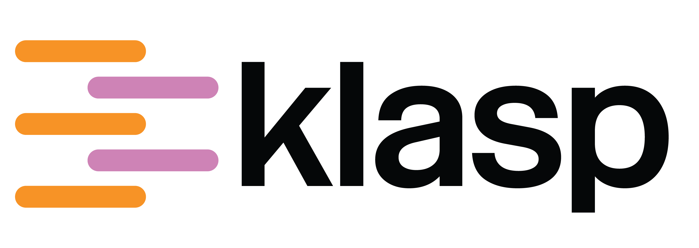

<p align="center">
  <picture>
    <source media="(prefers-color-scheme: dark)" srcset="docs/klasp-logo-dark.png">
    
  </picture>
</p>

GPU-accelerated crystal structure prediction for rigid molecules.

klasp generates trial crystal structures in chosen space groups and relaxes them
under a distributed-multipole force field. It can then re-rank the low-energy end
of a landscape with a PET machine-learned potential. It is built on [Kokkos], so
one source runs on CPUs, NVIDIA and AMD GPUs, and uses MPI across nodes.

> [!WARNING]
> **klasp is alpha software.** Commands, options, input formats, database
> contents and results can all change between versions without notice or
> backwards compatibility. Expect bugs. Check results before relying on them,
> and record the version you used (`klasp --version`).

## Building

Requires a C++20 compiler, CMake ≥ 3.22 and MPI. Every other dependency is
fetched at configure time.

```bash
cmake -B build -DKLASP_BACKEND=openmp     # serial | openmp | cuda | hip
cmake --build build -j
```

## Usage

### Running a search

A search needs one basis file per molecule: geometry, distributed multipoles and
pair potential (see [example-inputs](example-inputs)).

```bash
mpirun -n 8 ./build/klasp csp example-inputs/acetic_acid.json \
    --sg common10 --target 10000 -o run
```

This searches ten common space groups for 10,000 structures each and stores the
landscape in `run/csp.db`. A co-crystal search takes one basis file per
component. Add `--resume` to continue an interrupted run.

### Working with the results

```bash
./build/klasp summary run                          # per-space-group table, lowest structures
./build/klasp extract run/csp.db --unique -n 50 -o run   # lowest 50 as run/structures.cif
./build/klasp rerank run/csp.db --top 500          # re-relax the lowest 500 with PET
./build/klasp compack known.cif run/structures.cif # compare against a known form
```

`klasp --help` lists all commands, and `klasp <command> --help` lists each
command's options.

### Configuration

Every option is also a configuration key. `--dump-config` writes the
configuration a command line describes, `--config` reads one back, and
`--set section.key=value` overrides one key. Each run saves its full
configuration to `run/config.json`.

## Related projects

- [occ](https://github.com/peterspackman/occ) generates basis files:
  `occ dma <wavefunction> --write-csp-input molecule.json`.
- [pet-kokkos](https://github.com/peterspackman/pet-kokkos) is the PET backend,
  built automatically unless `-DKLASP_ENABLE_PET=OFF`.
- [pet-kokkos-models](https://huggingface.co/peterspackman/pet-kokkos-models)
  has the converted model weights. klasp searches `$KLASP_PET_MODEL_DIR`,
  `./models` and `~/.local/share/klasp/models`.

## Licence

BSD 3-Clause, see [LICENSE](LICENSE).

[Kokkos]: https://github.com/kokkos/kokkos
